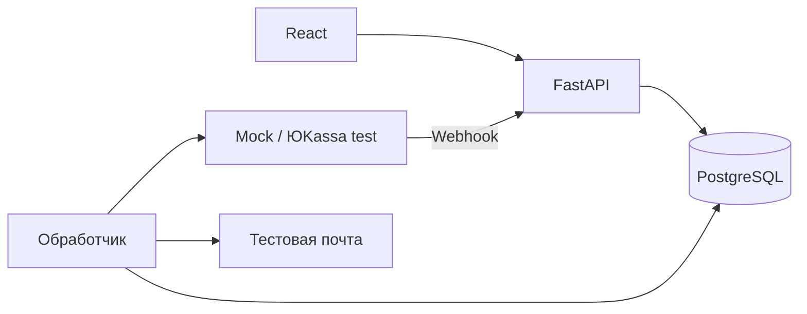
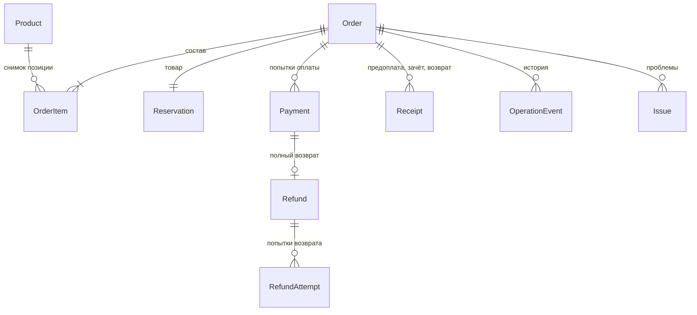

# Архитектура

Согласована 03.11.2026. Один модульный монолит: Python/FastAPI, SQLAlchemy 2, Alembic, Pydantic; PostgreSQL; React/TypeScript/Vite/shadcn/ui. Два процесса одного backend: API и восстанавливаемый фоновый обработчик. Docker Compose. Без брокеров сообщений и отдельных бизнес-микросервисов.



## Границы модулей

`api → services → repositories → models/database`. Роутеры отвечают за HTTP и доступ; сервисы — за правила и границы транзакций; репозитории — за запросы без самостоятельного commit. Интеграции переводят данные внешних сервисов. API и обработчик используют одни правила переходов.

## Данные

Product: физический/зарезервированный остаток. Order/OrderItem: неизменяемые снимки сумм и состава, владелец, доставка, состояние исполнения. Reservation: срок и состояние. PaymentAttempt: провайдер, его ID, постоянный ключ, снимок запроса, статус и состояние синхронизации. Refund: обязательство; RefundAttempt: история его исполнения. Receipt: вид, регистрация и доставка отдельно. OperationEvent: история. OperationalIssue: требующее решения расхождение. Служебные записи: сессии, входящие уведомления, письма, результат сверки.

Деньги: Decimal / NUMERIC(12,2), RUB; в JSON строки. Количества целые. Время UTC с часовым поясом. Порядок переходов определяется блокировкой и повторной проверкой состояния в БД.

## Жизненные циклы

- Order: placed → packing → shipped → completed; отмена до shipped → canceled.
- Reservation: held → allocated → consumed; отмена → released либо release_pending до возвращения на полку.
- Payment: pending → succeeded/canceled. До внешнего ответа ID/статус могут отсутствовать. Неизвестный результат запроса не равен отказу платежа.
- Refund: approval_required (при отмене покупателем) → requested → processing → succeeded; ошибка попытки → needs_attention, обязательство сохраняется.
- Receipt: planned → pending → registered/failed. Предоплата, зачёт и возврат — отдельные документы.

## Конкуренция и восстановление

Session создаётся на запрос/задачу. Оформление блокирует товары в стабильном порядке; заказ и резерв создаются атомарно. Изменения исполнения/оплаты блокируют заказ. Ограничения БД запрещают отрицательные остатки, несколько активных попыток и повторные внешние ID. Фактические лишние платежи сохраняются как проблема, не скрываются ограничением «одна успешная запись».

Внешние HTTP-запросы выполняются вне транзакций с блокировками. Сначала сохраняется намерение с ключом идемпотентности, затем внешний вызов, затем результат. Обработчик восстанавливает незавершённые операции после перезапуска. В пределах 24 часов повторяет неизменный запрос с исходным ключом; позднее требует сверки. Нельзя создавать независимую замену неизвестной операции.

Webhook сначала сохраняется; HTTP 200 означает сохранение для обработки. Доверие к состоянию появляется только после серверной проверки API, суммы, валюты, магазина, режима и привязки. Сверка применяет те же переходы. Поиск по периодам учитывает пагинацию; неоднозначные и неизвестные операции не присваиваются заказам по одной лишь сумме.

## Безопасность и интерфейсы

Гость видит заказы своей непрозрачной HttpOnly-сессии. Менеджер имеет отдельную авторизацию. Сервер проверяет полномочия и допустимость действия независимо от UI, изменяющие запросы проверяют Origin/CSRF. Нет команды произвольной установки paid. Секреты поступают из окружения. Разрешены только Mock и тестовые ключи ЮKassa; параметры запроса клиента не выбирают провайдера или сумму.

Frontend показывает отдельные состояния заказа, платежа, возврата и чеков и разрешённые backend действия. Фоновая сверка независима от открытой страницы. Администратор видит историю, проблемы и время последней проверки.

## История внедрения

1. Документация.
2. Рабочий магазин с ручной обработкой, проверками и меткой store-v0.
3. Миграция добавляет платежные сущности. Старые заказы сохраняют manual; новые получают online. Сохраняется исходный сценарий и история данных.
4. Отдельные коммиты платежей, адаптера ЮKassa, восстановления, возвратов, чеков и проверок.

## Первичные источники

- https://yookassa.ru/developers/payment-acceptance/getting-started/payment-process
- https://yookassa.ru/developers/using-api/interaction-format
- https://yookassa.ru/developers/using-api/webhooks
- https://yookassa.ru/developers/payment-acceptance/after-the-payment/refunds
- https://yookassa.ru/developers/payment-acceptance/receipts/54fz/other-services/payments
- https://yookassa.ru/developers/payment-acceptance/receipts/54fz/other-services/refunds
- https://yookassa.ru/developers/payment-acceptance/testing-and-going-live/testing
- https://docs.sqlalchemy.org/en/20/orm/session_basics.html
- https://fastapi.tiangolo.com/tutorial/background-tasks/
- https://ui.shadcn.com/docs/installation/vite

## Структура реализованного проекта

```text
backend/app/
  api/                    HTTP, сессии, права, webhook и демонстрационные действия
  core/                   конфигурация, SQLAlchemy Session, авторизация, ошибки
  models/                 склад/заказы и отдельные платёжные сущности
  repositories/           получение и блокировка заказа/позиций/товаров
  services/store.py       расчёт, снимок заказа, резерв, отмена, исполнение
  services/payments.py    допустимость оплаты, возврата и применения статусов
  services/processing.py  внешний вызов, inbox, сверка, чеки, отправка писем
  integrations/payments/  единый контракт, Mock и YooKassaProvider
  worker.py               периодический запуск обработки из той же кодовой базы
backend/alembic/          последовательные миграции основы и оплаты
backend/tests/            PostgreSQL-бизнес-тесты и HTTP-контракты адаптера
frontend/src/features/    catalog, checkout, order, manager
frontend/src/components/  небольшие общие компоненты и shadcn/ui
frontend/tests/           Playwright против работающих API и PostgreSQL
scripts/                  локальная конфигурация и проверка остановки/восстановления
```

У репозиториев нет самостоятельных commit. Сервисы владеют транзакциями и используют SQLAlchemy также для простых выборок и атомарных upsert. Отдельного универсального CRUD-слоя и скрытого управления транзакциями нет. Внешний Mock ведёт свой реестр независимыми транзакциями: он не устанавливает `paid` напрямую в заказе.



В коде `Payment` — попытка оплаты, `Issue` — операционная проблема. `Order.accepted_payment_id` указывает на оплату, разрешившую исполнение. У поздней оплаты отменённого заказа этот указатель не заполняется: денежный факт сохраняется в Payment, обязательство — в Refund. `Refund.status=approval_required` означает, что покупатель отменил уже оплаченный заказ и ждёт решения менеджера по возврату.

Состояние обмена с провайдером (`queued`, `unknown`, `known`, `rejected`, `blocked`) хранится отдельно от его статуса (`pending`, `succeeded`, `canceled`). `blocked` означает необходимость разбора, а не подтверждённый отказ банка. Подтверждённая возвращённая сумма не уменьшается из-за запоздалого ответа о платеже.

## Основные HTTP-контракты

| Доступ | Метод и путь с префиксом `/api` | Назначение |
|---|---|---|
| Публичный | `GET /products` | Каталог, текущая цена и доступный остаток |
| Публичный | `POST /session` | Непрозрачная гостевая сессия в HttpOnly-cookie |
| Публичный | `POST /checkout/quote` | Серверный расчёт и отпечаток для подтверждения цены |
| Покупатель | `POST /orders` | Снимок заказа и резерв, `checkout_key` защищает повтор |
| Покупатель | `GET /orders`, `GET /orders/{id}` | Только собственные заказы |
| Покупатель | `POST /orders/{id}/payments` | Сохранить намерение/вернуть существующую попытку, HTTP 202 |
| Покупатель | `POST /orders/{id}/cancel` | Отмена до комплектации |
| Менеджер | `POST /manager/login`, `/manager/logout` | Отдельная сессия менеджера |
| Менеджер | `GET /manager/orders`, `/manager/orders/{id}` | Заказы, история, деньги и разрешённые действия |
| Менеджер | `POST /manager/orders/{id}/{action}` | `start-packing`, `ship`, `complete`, `cancel`, `release-stock` |
| Менеджер | `POST /manager/orders/{id}/refunds` | Полный возврат/согласование возврата после отмены покупателем |
| Менеджер | `POST /manager/refunds/{id}/retry` | Новая попытка после известного отказа |
| Менеджер | `POST /manager/orders/{id}/reconcile` | Поставить существующие операции на ближайшую проверку |
| Менеджер | `GET /manager/issues` | Открытые проблемы и свежесть сверки |
| Провайдер | `POST /webhooks/yookassa` | Сохранить уведомление для проверки через API |

`/demo/payments/*` требует владельца заказа; `/manager/demo/*` требует менеджера. Обе группы выключены при `yookassa_test`. Внешние ID и состояния в теле webhook рассматриваются как неподтверждённый ввод. Уведомление не даёт права произвольно привязать платёж к заказу.

## Порядок обработки и эксплуатационный смысл

1. API фиксирует Payment/RefundAttempt с неизменяемым телом запроса и случайным ключом. Двойной клик упирается в блокировку заказа и частичный уникальный индекс активной попытки.
2. Обработчик фиксирует время первой отправки, завершает транзакцию, вызывает провайдера, затем в новой транзакции блокирует заказ и применяет проверенный результат.
3. После таймаута сохраняется `unknown`. Повтор использует тот же ключ и тело. Даже ошибка авторизации при таком повторе не доказывает, что первая операция не выполнилась.
4. Гарантия идемпотентности ЮKassa ограничена 24 часами; автоматический POST останавливается с запасом в 5 минут. Сверка платежей может восстановить потерянный ID по метаданным. Возврат без однозначной связи становится видимой проблемой, совпадения суммы недостаточно.
5. Worker просыпается каждые 2 секунды, денежные состояния сверяются обычно раз в 60 секунд. Полный просмотр списков берёт последние 48 часов и более старые активные платежи, проходит все страницы. Все известные незавершённые операции проверяются отдельно; состояния известных успешных платежей также перечитываются для обнаружения внешних возвратов.
6. Перед освобождением просроченного резерва выполняется дополнительная проверка активной оплаты. Если провайдер недоступен, товар всё равно освобождается, а денежная проверка продолжается. Заказ не восстанавливается при позднем успехе — запускается возврат.
7. Несколько worker-процессов не обрабатывают задачи одновременно: используется advisory lock PostgreSQL на время прохода, без открытой транзакции с бизнес-блокировками на время HTTP. После падения процесса блокировка освобождается соединением, намерения остаются в БД.
8. Письмо создаётся атомарно с подтверждением денег, по уникальному ключу события. SMTP работает как доставка с возможными повторами: падение после принятия письма может привести к повторной отправке с тем же Message-ID. Денежный эффект и резерв от письма не зависят.

При недоступной сверке менеджер видит проблему либо устаревшую дату. Отсутствие webhook не превращает оплату в отказ. Уже подтверждённая ошибка фискализации блокирует отправку товара, но не комплектацию; задержка регистрации отображается отдельно. В MVP `Receipt.delivery_status` остаётся `not_confirmed`: доказательства доставки фискального документа нет.

## План внедрения за три недели

| Период | Результат и критерий приёмки |
|---|---|
| Дни 1–2 | Уточнить склад, отмену, возвраты, кассу и ответственных; согласовать правила и получить тестовые реквизиты |
| Дни 3–4 | Зафиксировать исходный магазин, тесты существующего процесса, план миграции старых заказов |
| Дни 5–7 | Добавить сущности, одну активную оплату, адаптеры, доступ покупателя и платёжный экран |
| Дни 8–10 | Проверяемые webhook, восстановление после сбоев, сверка, мониторинг проблем и интерфейс менеджера |
| Дни 11–12 | Полные возвраты, ошибки, фискальные состояния и подтверждения покупателю |
| Дни 13–14 | Конкурентные и браузерные тесты, реальный тестовый магазин/касса, приёмка миграции и инструкций |
| День 15 | Совместная демонстрация, резерв на исправления, решение о готовности к отдельному боевому запуску |

Это план реального внедрения, а не заявление о выполненных внешних проверках. В данном репозитории эти логические этапы сохранены коммитами; фактические результаты и непроверенные внешние зависимости перечислены в VERIFICATION.md.

Дополнительный источник по сборке и закреплению образов: [официальные рекомендации Docker](https://docs.docker.com/build/building/best-practices/). Обновление закреплённых образов и библиотек требует повторного прогона проверок.
