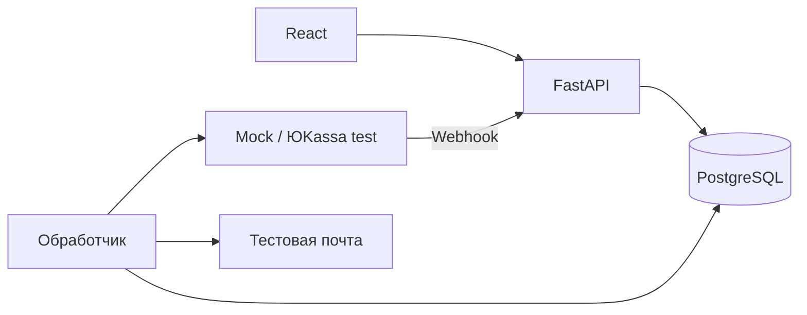

# Архитектура

Согласована 03.11.2026. Один модульный монолит: Python/FastAPI, SQLAlchemy 2, Alembic, Pydantic; PostgreSQL; React/TypeScript/Vite/shadcn/ui. Два процесса одного backend: API и восстанавливаемый фоновый обработчик. Docker Compose. Без брокеров сообщений и отдельных бизнес-микросервисов.

## Границы модулей

`api → services → repositories → models/database`. Роутеры отвечают за HTTP и доступ; сервисы — за правила и границы транзакций; репозитории — за запросы без самостоятельного commit. Интеграции переводят данные внешних сервисов. API и обработчик используют одни правила переходов.

## Данные

Product: физический/зарезервированный остаток. Order/OrderItem: неизменяемые снимки сумм и состава, владелец, доставка, состояние исполнения. Reservation: срок и состояние. PaymentAttempt: провайдер, его ID, постоянный ключ, снимок запроса, статус и состояние синхронизации. Refund: обязательство; RefundAttempt: история его исполнения. Receipt: вид, регистрация и доставка отдельно. OperationEvent: история. OperationalIssue: требующее решения расхождение. Служебные записи: сессии, входящие уведомления, письма, результат сверки.

Деньги: Decimal / NUMERIC(12,2), RUB; в JSON строки. Количества целые. Время UTC с часовым поясом. Порядок переходов определяется блокировкой и повторной проверкой состояния в БД.

## Жизненные циклы

- Order: placed → packing → shipped → completed; отмена до shipped → canceled.
- Reservation: held → allocated → consumed; отмена → released либо release_pending до возвращения на полку.
- Payment: pending → succeeded/canceled. До внешнего ответа ID/статус могут отсутствовать. Неизвестный результат запроса не равен отказу платежа.
- Refund: requested → processing → succeeded; ошибка попытки → needs_attention, обязательство сохраняется.
- Receipt: planned → pending → registered/failed. Предоплата, зачёт и возврат — отдельные документы.

## Конкуренция и восстановление

Session создаётся на запрос/задачу. Оформление блокирует товары в стабильном порядке; заказ и резерв создаются атомарно. Изменения исполнения/оплаты блокируют заказ. Ограничения БД запрещают отрицательные остатки, несколько активных попыток и повторные внешние ID. Фактические лишние платежи сохраняются как проблема, не скрываются ограничением «одна успешная запись».

Внешние HTTP-запросы выполняются вне транзакций с блокировками. Сначала сохраняется намерение с ключом идемпотентности, затем внешний вызов, затем результат. Обработчик восстанавливает незавершённые операции после перезапуска. В пределах 24 часов повторяет неизменный запрос с исходным ключом; позднее требует сверки. Нельзя создавать независимую замену неизвестной операции.

Webhook сначала сохраняется; HTTP 200 означает сохранение для обработки. Доверие к состоянию появляется только после серверной проверки API, суммы, валюты, магазина, режима и привязки. Сверка применяет те же переходы. Поиск по периодам учитывает пагинацию; неоднозначные и неизвестные операции не присваиваются заказам по одной лишь сумме.

## Безопасность и интерфейсы

Гость видит заказы своей непрозрачной HttpOnly-сессии. Менеджер имеет отдельную авторизацию. Сервер проверяет полномочия и допустимость действия независимо от UI, изменяющие запросы проверяют Origin/CSRF. Нет команды произвольной установки paid. Секреты поступают из окружения. Разрешены только Mock и тестовые ключи ЮKassa; параметры запроса клиента не выбирают провайдера или сумму.

Frontend показывает отдельные состояния заказа, платежа, возврата и чеков и разрешённые backend действия. Фоновая сверка независима от открытой страницы. Администратор видит историю, проблемы и время последней проверки.

## История внедрения

1. Документация.
2. Рабочий магазин с ручной обработкой, проверками и меткой store-v0.
3. Миграция добавляет платежные сущности. Старые заказы сохраняют manual; новые получают online. Сохраняется исходный сценарий и история данных.
4. Отдельные коммиты платежей, адаптера ЮKassa, восстановления, возвратов, чеков и проверок.

## Первичные источники

- https://yookassa.ru/developers/payment-acceptance/getting-started/payment-process
- https://yookassa.ru/developers/using-api/interaction-format
- https://yookassa.ru/developers/using-api/webhooks
- https://yookassa.ru/developers/payment-acceptance/after-the-payment/refunds
- https://yookassa.ru/developers/payment-acceptance/receipts/54fz/other-services/payments
- https://yookassa.ru/developers/payment-acceptance/receipts/54fz/other-services/refunds
- https://yookassa.ru/developers/payment-acceptance/testing-and-going-live/testing
- https://docs.sqlalchemy.org/en/20/orm/session_basics.html
- https://fastapi.tiangolo.com/tutorial/background-tasks/
- https://ui.shadcn.com/docs/installation/vite
